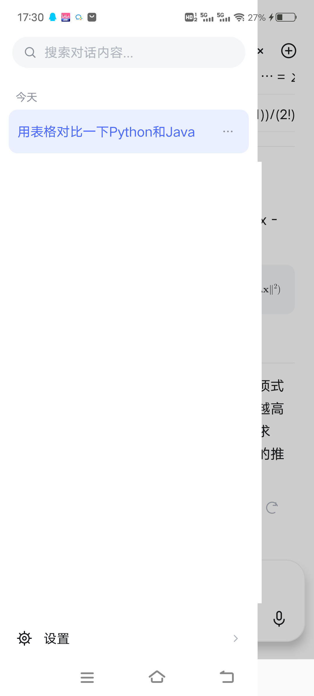
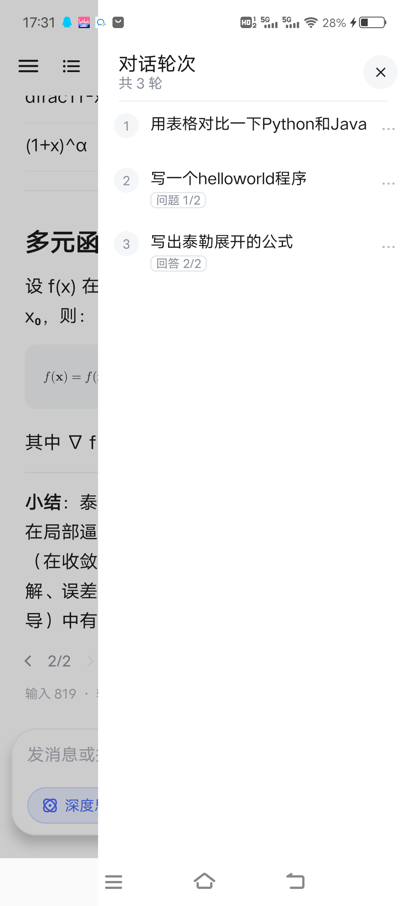
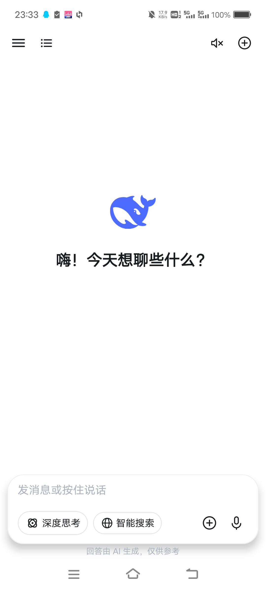
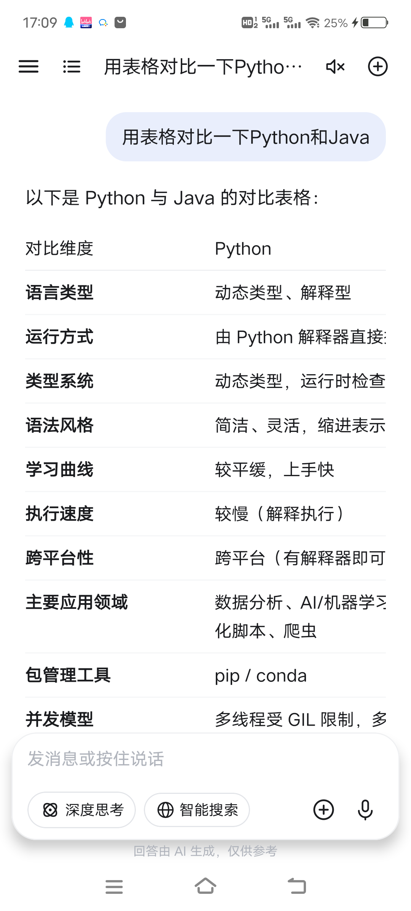
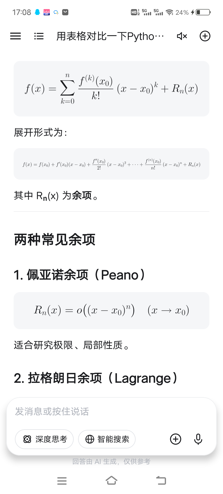
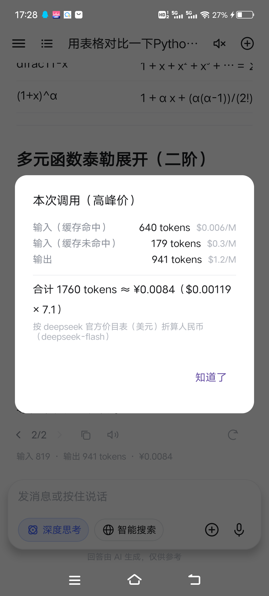
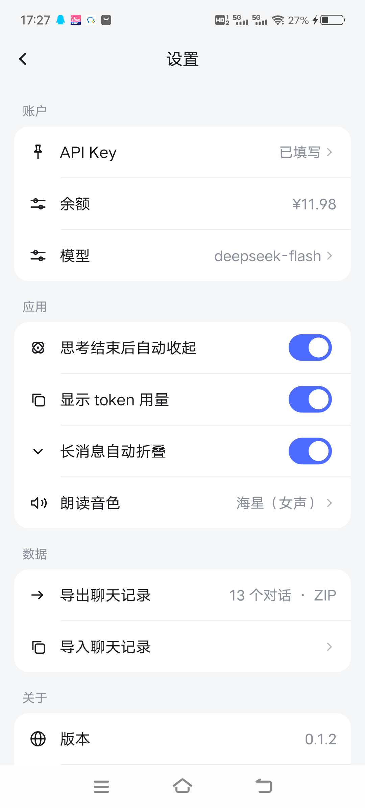

# dsapp · DeepSeek 本地版（Android）

官方 App 的界面 + 官方开源 Demo 的协议，纯 Kotlin + Jetpack Compose 重写。
**官方 App 的能力全部实现**，另外补了官方没有的**花费显示**和**轮次边栏**。
对话和 Key 只存在手机上，不经过任何第三方服务器。

> 非官方项目，与深度求索无关。

<p align="center">
  
  
  
  
  
</p>
<p align="center">
  
  
</p>

## 下载

**[⬇ 最新 APK](https://github.com/Oblaanlein/deepseek-local-android/releases/latest)** —— 要求 Android 8.0（API 26）及以上，安装后到「抽屉 → 设置」填自己的 API Key。

---

## 功能

### 官方 App 的能力：全部复原

| 分类 | 能力 |
|---|---|
| 对话 | 流式输出、停止生成、复制、Markdown 渲染（代码块/表格/列表/引用/链接） |
| 推理 | 深度思考（独立内容块、计时、可折叠）、思考与回答分开展示 |
| 联网 | 智能搜索、搜索过程提示、**引用来源列表**（可点击打开） |
| 多模态 | 拍照 / 相册 / 文件上传、语音输入、朗读（服务端 TTS，两种音色） |
| 分支 | 重新生成、修改提问，**`‹ 1/2 ›` 翻页器**在同父节点的分支间切换 |
| 会话 | 历史抽屉（按今天/昨天/7 天内分组）、全文搜索、重命名、置顶、多选删除 |
| 交互 | 长按菜单（会话项 / 提问 / 回答三套）、选择文本（自由框选）、复制反馈 |
| 数据 | 导入导出**官方格式 ZIP**（`export_format_version = 3`），官方备份可直接导入 |
| 外观 | 明暗主题跟随系统、自适应图标 |

### 官方 App 没有、这里新增的

**1. 每条回答显示花费（人民币）**

回答下方显示 `输入 N · 输出 M tokens · ¥金额`。点一下弹出明细：

```
本次调用（低谷价）
输入（缓存命中）    0 tokens   $0.006/M
输入（缓存未命中）  22 tokens  $0.3/M
输出               28 tokens   $1.2/M
────────────────────────────
合计 50 tokens ≈ ¥0.0001（$0.00002 × 7.1）
```

单价按官方价目表**分项计价**，并实现**峰谷价**：UTC 01–04、06–10 之外是低谷，单价减半；周末全天低谷。

**2. 账户余额查询**

设置 → 账户 → 余额，点一下查当前账户余额（`GET /user/balance`），支持多币种，不可用时会有标注。

**3. 右侧「对话轮次」边栏**

顶栏「目录」图标唤出，也可以**在对话区左滑**打开。列出每一轮提问，带分支标记（`问题 2/2`、`回答 1/2`），
每条可以：跳到这一轮 / **修改这一轮** / **重新生成回答** / **删除这一轮**（摘掉该轮及其子树，后面的轮次自动接上）。

官方 App 只能滚着找历史，也没有「删单轮」。

**4. 其他**

- 左滑/右滑双向唤出边栏（右滑开历史抽屉，左滑开轮次栏）
- 长按会话可多选批量置顶/删除
- 搜索是**全文搜索**（搜标题也搜消息正文，结果带摘要片段和分支标记），不是只匹配标题
- 双击顶栏标题回到对话最顶端

---

## 更新日志

### v0.1.2

**排版对齐官方（逐像素量过）**
- 正文 16/26，左右留白 22dp（实测官方 24.5dp），段间距按 CSS margin 折叠
- 列表圆点改为 4dp 实心圆，**左切线与正文左边缘对齐**，项间距放宽
- 标题按 h1~h4 分级字号；表格 15/25、只有横向分隔线、列宽按内容自适应、超屏横向滚动
- 公式改用 **JLaTeXMath 真排版**（分式上下叠、求和号带上下限），支持 `$$…$$`、`\[…\]`、`\(…\)`、`$…$` 四种写法
- 代码块 12dp 圆角、13/22 等宽

**交互**
- 点击用户消息直接进入编辑；输入框随文本增高，到 6 行后内部滚动
- 长消息自动折叠（截断处淡出 + 圆形下箭头），设置里可关，默认开
- 流式输出时可以自由上下翻，不再被拽回底部；滚动时不再闪长按灰底
- 双击标题回到对话顶部；轮次栏远距离跳转改为瞬移

**性能**
- 分支切换：去掉每次点击的「全库重读 + 解析」（这是之前切换卡顿的根因），改为异步落盘 + 内存替换
- 切换后按消息溢出量补滚，分页按钮停在原位，可以连续点击
- Markdown 解析结果做缓存，来回切分支不重复解析

**其他**
- 顶栏标题过长省略号，不再压住两侧图标
- **新增账户余额查询**：设置 → 账户 → 余额，点一下查当前余额（`GET /user/balance`）
- 设置里的版本号改为读取 BuildConfig

### v0.1.1

- 修复导入官方 ZIP 报「压缩包里没有找到会话」（官方是流式 zip，`ZipInputStream` 读不了，改用 `ZipFile`）
- 导入改成进度弹窗，失败时给出具体文件名和异常

---

## 跑起来

```bash
# 环境：JDK 17+、Android SDK（compileSdk 36 / minSdk 26）
./gradlew :app:assembleDebug
adb install -r app/build/outputs/apk/debug/app-debug.apk
```

首次使用：抽屉 → 设置 → 填 API Key（弹窗里可点「测试连接」验证，走 `GET /models` 不产生费用）。

---

## 技术说明

### 为什么用 Anthropic 兼容接口

官方 Demo 用的是 `POST https://api.deepseek.com/anthropic/v1/messages`，返回**内容块流**
（`text` / `thinking` / `server_tool_use`）并带网页引用 `citations`。

「已思考（用时 X 秒）」和联网搜索的来源，只有这个接口能拿到。
`/chat/completions` 只有 `reasoning_content` 一个字段，做不出官方那种形态。

### 消息树

会话不是线性数组，而是树：每条消息有 `parentId`，父节点用 `selectedChildId` 指向当前选中的孩子。
「重新生成」「修改提问」不是覆盖，而是**新增兄弟节点**，翻页器在同一父节点的兄弟间切换。

按轮删除的做法：摘掉该轮及其子树，把下一轮接回上一轮的父节点，否则上下文会断。

### 代码结构

```
app/src/main/java/com/local/dsapp/
├─ data/
│  ├─ Model.kt      Session / Msg / Block / Citation / Attachment，含 JSON 与消息树操作
│  ├─ Store.kt      SharedPreferences 存 JSON；Settings 存 Key/模型/音色/开关
│  ├─ Pricing.kt    价目表、峰谷判定、人民币折算
│  └─ Backup.kt     官方 v3 ZIP 的读写
├─ net/
│  ├─ Api.kt        请求体组装 + SSE 逐行解析（照搬官方 client.ts）
│  └─ SpeechApi.kt  服务端 TTS（裸 PCM 流）
└─ ui/
   ├─ ChatScreen.kt     对话页、手势、滚动跟随
   ├─ MessageItem.kt    消息渲染、长按菜单、操作行
   ├─ InputCard.kt      输入卡片、附件面板、语音输入
   ├─ Drawer.kt         左侧历史抽屉（搜索/置顶/多选）
   ├─ TurnsPanel.kt     右侧轮次栏
   ├─ ReadAloud.kt      朗读：AudioTrack 流式播放
   ├─ ReadingBars.kt    朗读中的四根跳动竖条
   ├─ Markdown.kt       Markdown 渲染（表格/代码块/列表）
   ├─ Latex.kt          LaTeX 兜底转换（解析失败时用）
   ├─ MathRender.kt     公式：JLaTeXMath 渲染成位图 + 缓存
   └─ SettingsScreen.kt 设置页
```

---

## 构建时的坑

都踩过了，记下来省得再踩：

- **AGP 9 内置 Kotlin**：不要再套 `org.jetbrains.kotlin.android` 插件，否则版本打架
- **Gradle 镜像**：`distributionUrl` 走腾讯镜像，`networkTimeout` 要调大，否则首次下载容易断
- **自适应图标**：前景必须自己按 66dp 安全区缩放，否则边缘元素会被圆形遮罩切掉
- **Compose 长按**：`combinedClickable` 要挂在外层有 `fillMaxWidth` 的容器上，挂在随内容宽度浮动的内层容器上会命中不到
- **PCM 播放**：16-bit 采样跨网络分片时要保留奇数字节，否则后续全部错位成噪音
- **`LazyListState.scrollToItem`** 是把该条**对齐到顶部**，不是滚到底；贴底要再 `scrollBy` 一大截由框架钳住
- **`horizontalScroll` 里宽度无界**：`fillMaxWidth` 会算成 0（表格分隔线因此消失），必须给显式宽度

---

## 第三方依赖

| 依赖 | 用途 | 许可 |
|---|---|---|
| [jlatexmath-android](https://github.com/noties/jlatexmath-android) | 数学公式解析与排版 | **GPL-2.0** |

> 公式渲染依赖 JLaTeXMath（GPL-2.0）。按 GPL 的传染性，**包含该依赖的构建产物需按 GPL-2.0 分发**。
> 本仓库源码公开，符合 GPL 的源码提供要求；二次分发请保留同样的许可。

---

## 隐私

- API Key：存在应用私有 `SharedPreferences`
- 聊天记录与附件：存在应用私有目录，卸载即清除
- 网络：只直连 `https://api.deepseek.com`
- 本仓库不含任何 Key、不含任何聊天记录

---

## 免责声明

**这是一个 AI 辅助开发的项目。** 界面还原、协议对接、代码实现与调试主要由 AI 完成，人工只负责提出需求与验证结果。
因此代码中可能存在未被发现的问题（包括但不限于数据丢失、请求异常、费用误算），请自行评估风险后使用。

非官方项目，与深度求索（DeepSeek）无关，界面与协议的还原仅用于学习交流。
使用需自备 API Key，费用由你的账号承担。
